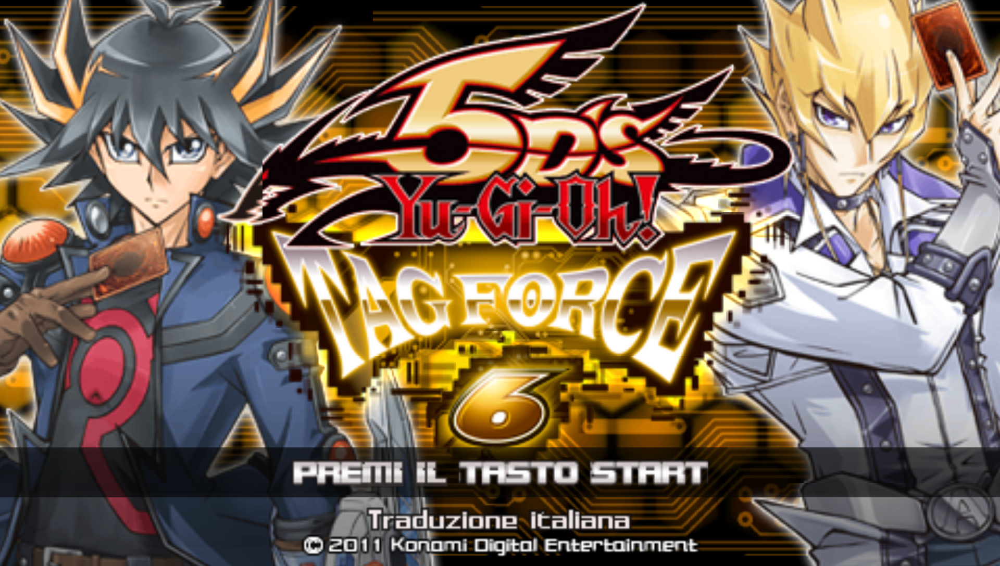
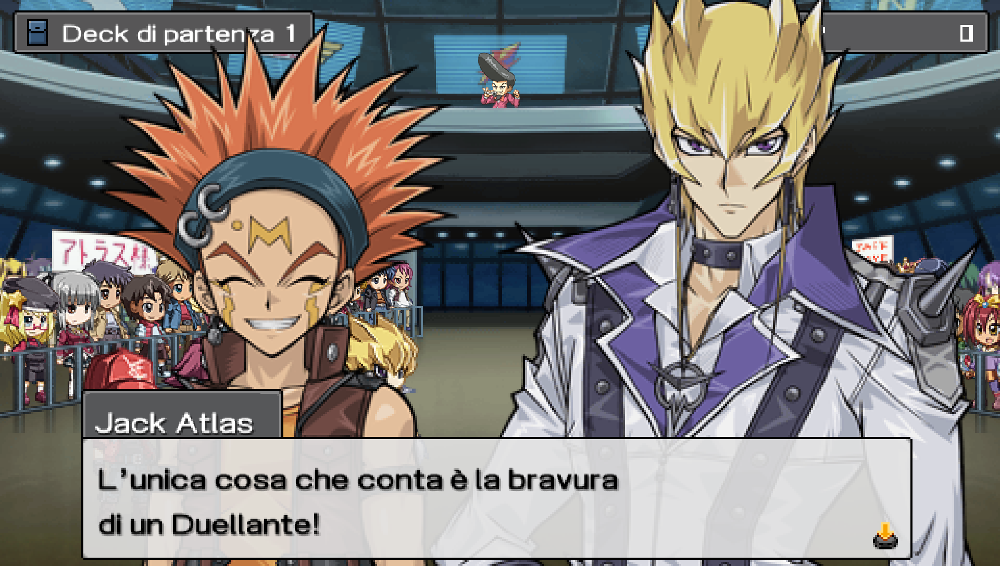
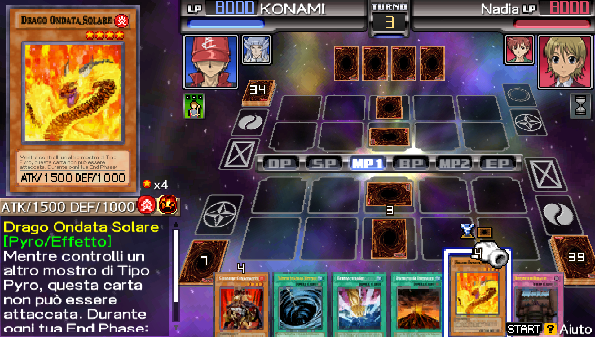
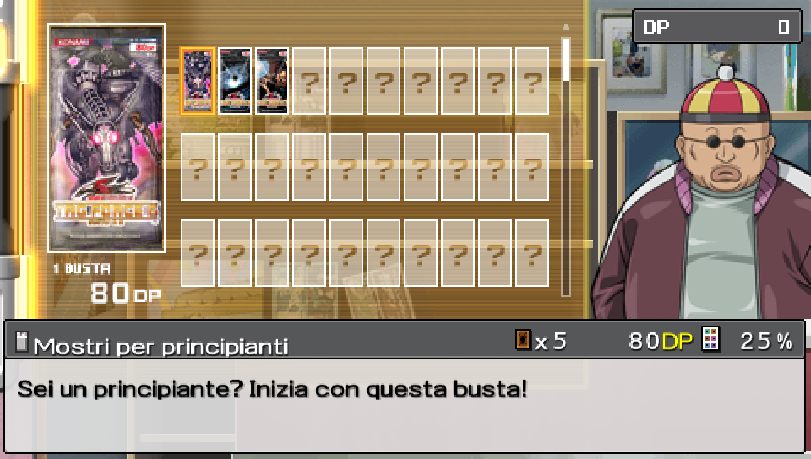
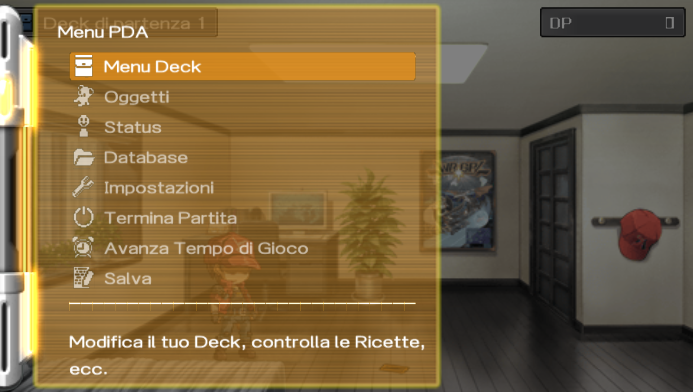
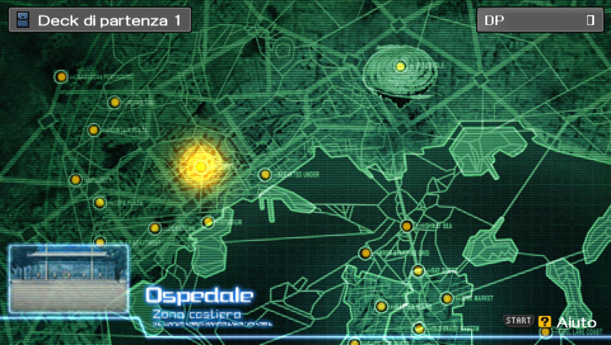

# Yu-Gi-Oh! 5D's Tag Force 6 - Traduzione italiana

Traduzione amatoriale in italiano di Yu-Gi-Oh! 5D's Tag Force 6 per PSP, uscito solo in Giappone (ULJM-05940).

Ho tradotto la modalità storia, i menu, i duelli, le battute dei personaggi, il database delle carte, il negozio, la guida per principianti, le opzioni e le grafiche.

Le carte hanno i nomi e i testi ufficiali italiani di Konami, gli stessi che trovate sulle carte vere. I personaggi si chiamano come nel doppiaggio italiano dell’anime: Akiza, Trudge, Leo, Luna, Kalin e così via. La storia l’ho ritradotta confrontandola con il testo giapponese originale.
## Screenshot

  
  
  
  
  
  

## Download

La patch si scarica dalla pagina [Releases](https://github.com/guccimanu/TF6-ITA/releases/latest) (file `TF6_ITA_v1.0.zip`).

Nello zip ci sono solo la patch `TF6_ITA.xdelta` e il file `LEGGIMI.txt`. La ISO del gioco non è inclusa.

## Cosa serve

Serve la ISO giapponese originale del gioco. La patch funziona solo con questo file:

- Dimensione: 1.717.600.256 byte
- MD5: `0B601B66F9A5D86FA2DC7045A1EBEF1D`

## Come applicare la patch

Su Windows con [Delta Patcher](https://github.com/marco-calautti/DeltaPatcher/releases):

1. In "Original file" scegli la ISO giapponese.
2. In "XDelta patch" scegli `TF6_ITA.xdelta`.
3. Premi "Apply patch".

Su Android si può usare UniPatcher, scegliendo la patch e la ISO giapponese.

La ISO italiana ottenuta deve avere MD5 `4E00260C7C9DE449C0D2E8A0F96A286A`. Se è diverso, la ISO giapponese di partenza non è quella giusta.

## Note

- Provata su PPSSPP.
- I salvataggi della versione giapponese sono compatibili.
- Alcuni trucchi della versione originale possono rovinare il salvataggio. Per esempio "DP 99999999" crea oggetti vuoti nell'inventario che fanno crashare il gioco se li regali. Se usate i trucchi fate prima una copia del salvataggio.
- La modalità Network (ad hoc) non l'ho provata.

## Crediti

- Traduzione italiana: Gucci Manu
- Patch iniziale: Omarrrio & XenoTranslations, nzxth2, Yugipedia User Modata
- Traduzione originale della storia: Clickclaxer01
- Ritraduzione della storia, pacchetti di carte e profili dei duellanti: Gucci Manu

Grazie a nzxth2 e a tutti quelli che hanno lavorato alla traduzione inglese, senza la quale questo progetto non sarebbe esistito. Un grazie in particolare a nzxth2 per avermi dato il via libera a settembre 2026 ([qui la richiesta](https://github.com/nzxth2/tf6-translation/issues/5)).

## Donazioni

La traduzione è gratuita. Se vi è piaciuta e volete supportare il lavoro e le prossime traduzioni potete lasciare una donazione libera su [paypal.me/manudangelo98](https://paypal.me/manudangelo98).

## Avviso

Traduzione amatoriale non ufficiale e senza scopo di lucro, non affiliata né approvata da Konami. Yu-Gi-Oh! e i relativi marchi appartengono ai rispettivi proprietari. Qui non trovate la ISO del gioco e non chiedetela nelle Issues.
